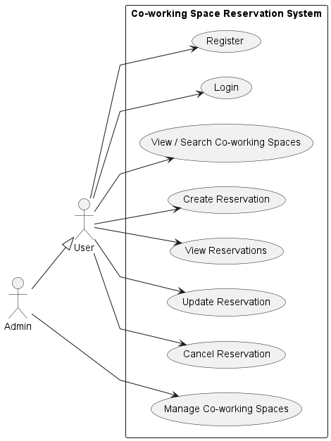
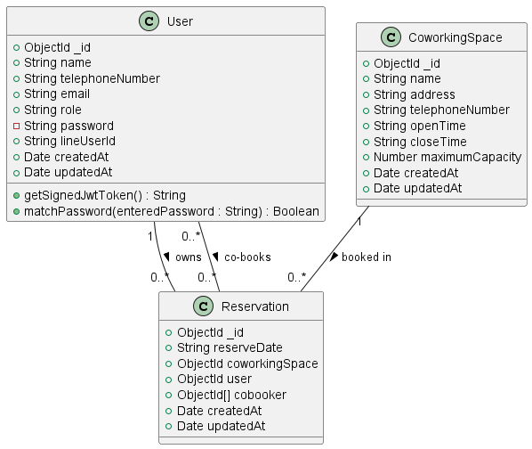
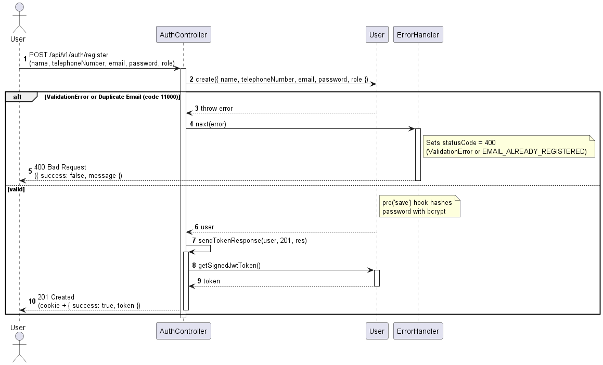
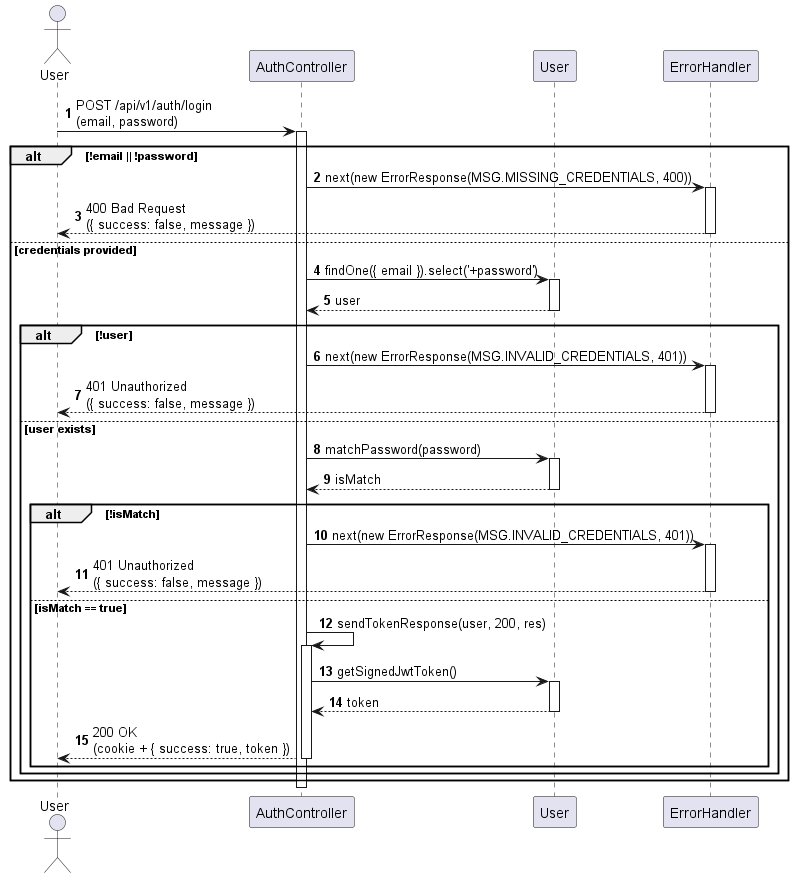
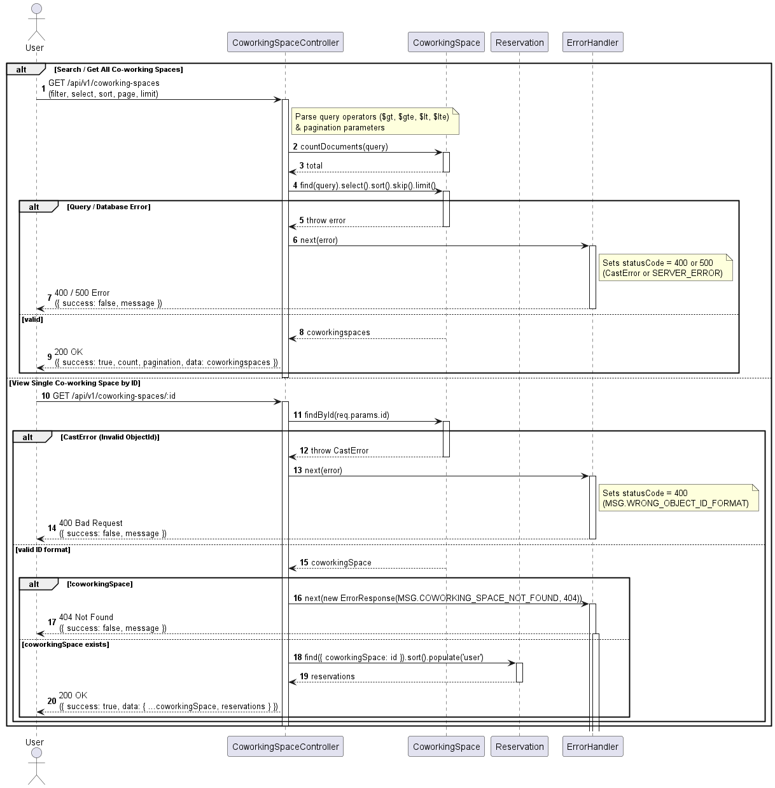
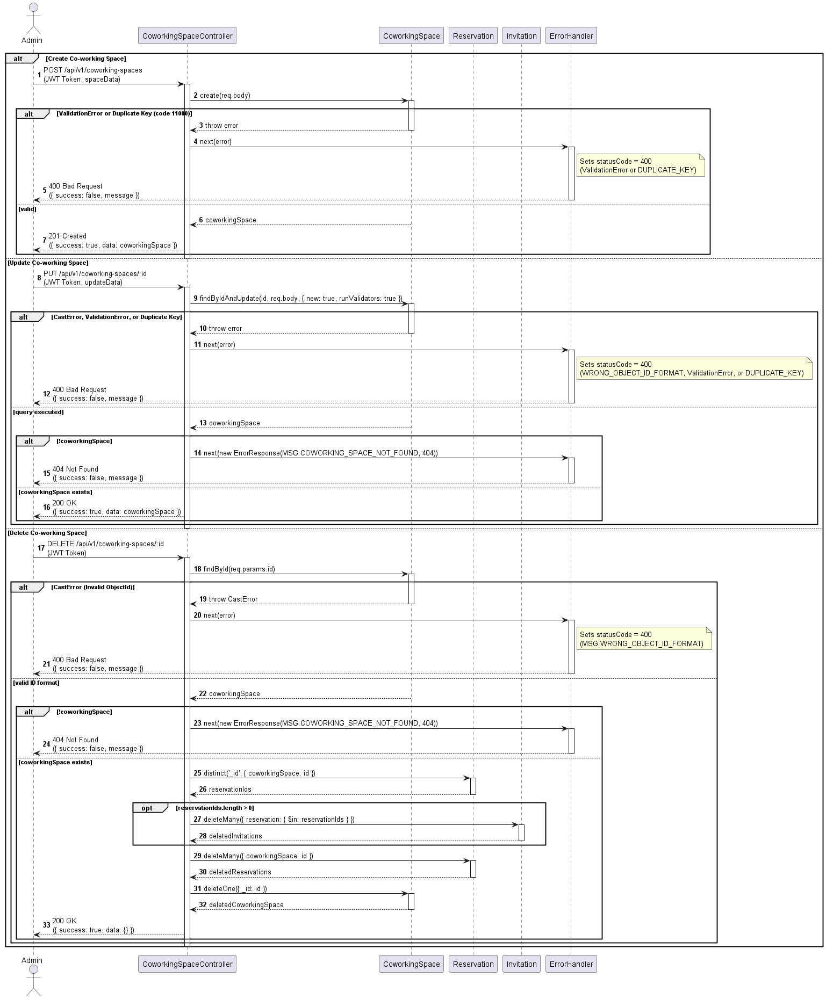
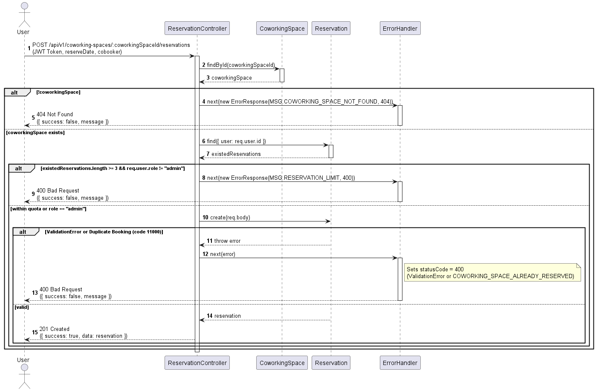
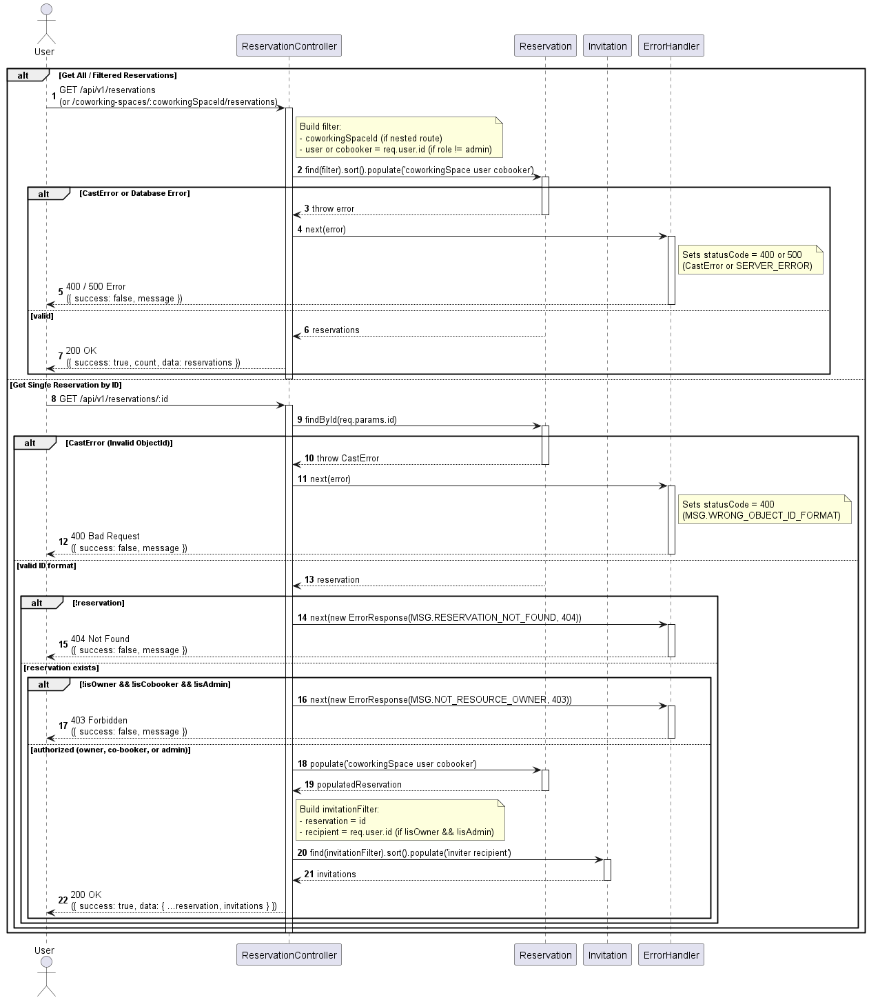
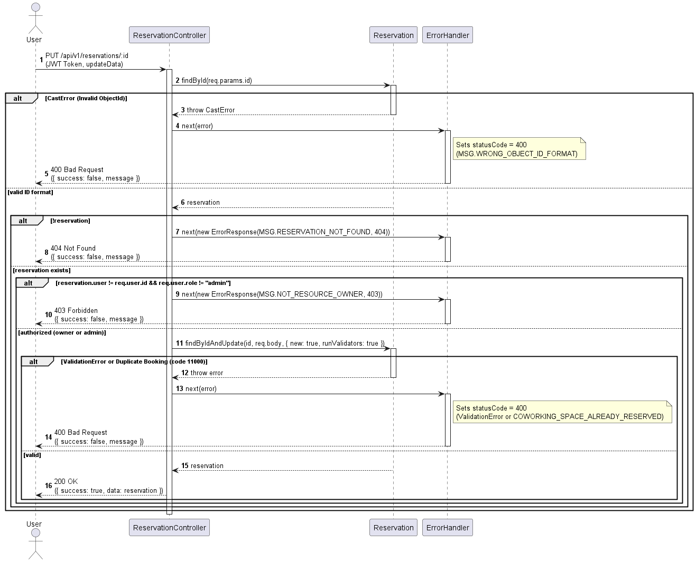
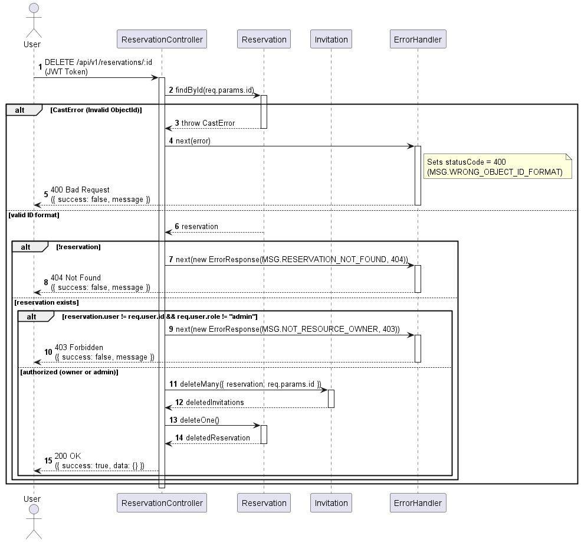

# System Architecture & UML Diagrams

System architecture design and workflow diagrams for the **Co-working Space Reservation System**.

## 1. Use Case Diagram

Overview of the system scope and access permissions for all actors (`User` and `Admin`).

---

## 2. Class Diagram

Data model structures, database relationships (`User`, `CoworkingSpace`, `Reservation`, `Invitation`), and controllers.

---

## 3. Sequence Diagrams

Execution workflows between the Client, Controller, Database Schema, and Centralized Error Handler for each use case.

### 3.1 Authentication

* **Register**

  

* **Login**

  

### 3.2 Co-working Spaces

* **View / Search Co-working Spaces**

  

* **Manage Co-working Spaces (Admin)**

  

### 3.3 Reservations

* **Create Reservation**

  

* **View Reservations**

  

* **Update Reservation**

  

* **Cancel Reservation**

  
